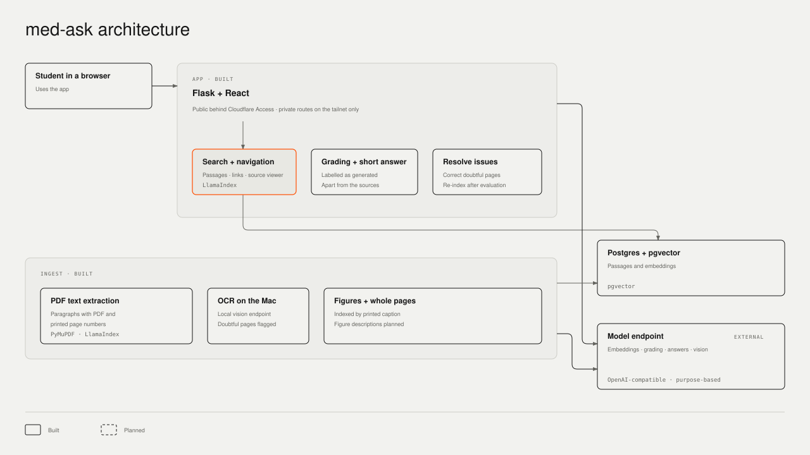

# med-ask

Search across medical textbooks for the original passages behind an answer. med-ask keeps source evidence and generated text visibly separate, and links evidence back to its book pages.

> [!WARNING]
> **In development.** Four of 13 books are indexed today. Search results and generated answers may change as the remaining books are added in stages.

## Overview

Built for a medical student working across 13 textbooks and about 12,500 pages. The public site is behind Cloudflare Access; private issue-resolution routes are served only on the tailnet.

- **Search:** searches four books, two in English and two in Spanish. It returns original passages with the book, PDF page and printed page, grades candidates for relevance, then writes a short answer labelled as generated and apart from the sources. Open translation is cached.
- **Figures:** indexes figures as separate entries by printed caption. Passages link to figures they mention; opening one shows its whole page. In one atlas, each lettered panel has its own entry. Figure descriptions are not built.
- **Navigation:** figure, table, section, chapter and page references link to a quick look. **Review source** opens a book viewer with every page, breadcrumbs and a contents tree.
- **Scanned pages:** a local vision model on a Mac reads scanned pages through an OpenAI-compatible endpoint. Doubtful pages are marked “from OCR — check the page”. A private **Resolve issues** screen on the tailnet lets the owner correct them.
- **Indexes:** indexes are versioned with `INDEX_VERSION`. A new index is switched in only after a retrieval evaluation shows it is no worse.

The repository contains code only. Book text, passages, page images, vectors, figure and navigation data, evaluation questions, question logs, emails, secrets and `.env` files stay outside it. The [no-data guard](scripts/check_no_data.py) and CI enforce this rule; CI also runs gitleaks, and tests use synthetic content.

## Architecture

<picture><source media="(prefers-color-scheme: dark)" srcset="docs/diagrams/architecture-dark.svg"></picture>

Solid parts are built; dashed parts are planned.

- Flask + Gunicorn serves the React 19 + Vite interface and API.
- PyMuPDF extracts pages; LlamaIndex owns indexing and retrieval in Postgres + pgvector. Index versions are evaluated before switching.
- Models use purposes such as `chat`, `embed`, `grade` and `vision` through an OpenAI-compatible endpoint, with its base URL and key supplied by the environment.
- Scanned-page OCR uses a local vision model on a Mac. Figures are indexed from printed captions; generated figure descriptions are not part of search.

## Quick start

### Local checks

Use Python 3.13 with uv and a Node version supported by Vite (CI uses Node 24). No container runtime is needed on the Mac.

```sh
uv sync --locked
uv run pytest
uv run ruff check .
uv run ruff format --check .
uv run python scripts/check_no_data.py
npm --prefix frontend ci
npm --prefix frontend run build
gitleaks git --redact --log-opts=--all
```

The guard checks tracked files only. Tests generate synthetic content in temporary directories, never in committed fixtures. Front-end build output is ignored.

### Compose on a Linux host

Use an x86-64 Linux host with Docker and the Compose plugin. Copy `.env.example` to `.env` and replace the placeholder with a random URL-safe password before starting. The environment file is ignored and excluded from the image build.

```sh
cp .env.example .env
# Edit .env to set POSTGRES_PASSWORD.
docker compose up -d --build --wait
curl --fail http://127.0.0.1:8100/
curl --fail http://127.0.0.1:8100/api/health
docker compose down
```

Open `http://127.0.0.1:8100/` on that host. Flask serves the compiled React app and `/api/` from one container and origin, using Gunicorn as the WSGI server. `/api/health` returns `{"postgres":"ok","vector":"ok"}` when Postgres is reachable and its vector extension exists; otherwise it returns HTTP 503. Unknown API routes return 404. The app uses an OpenAI-compatible model endpoint configured through environment variables.

## Project structure

```text
src/med_ask/  # Flask app and RAG core
frontend/     # React interface and Vite build
deploy/       # Systemd service and timer units
scripts/      # Repository checks
postgres/     # Database initialization
tests/        # Automated tests
```

The corpus has 13 books; four are indexed, and the remaining nine are planned for staged addition. See the [operator runbook](docs/operations.md) for deployment, access, indexing, search and retrieval evaluation.

## Licence

[AGPL-3.0](LICENSE), including PyMuPDF's licensing requirements.
