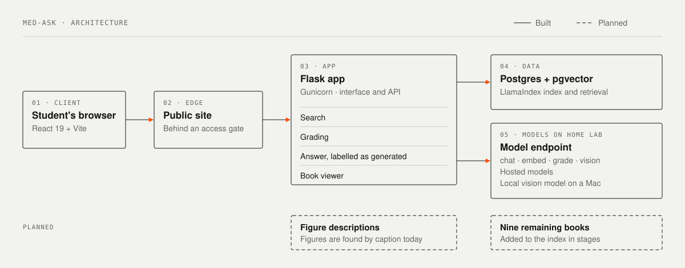
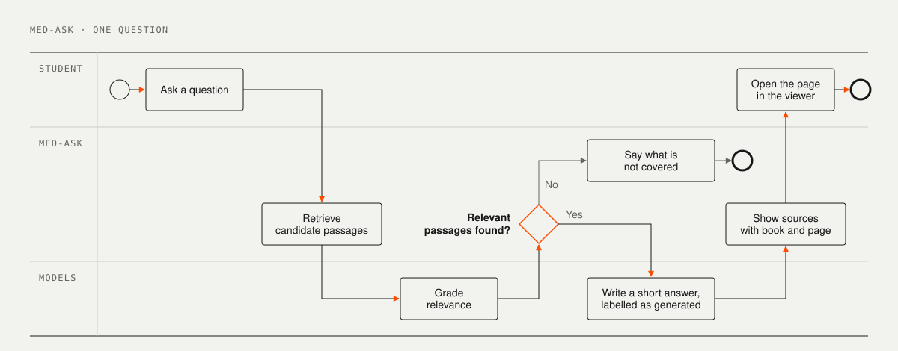

# med-ask

Search across medical textbooks that returns the original passages, with book and page, before any generated answer.

> [!NOTE]
> **In use.** Four of the 13 books are indexed. The other nine are added in stages. Figure descriptions are not built.

## Why it exists

A medical student works across 13 textbooks, about 12,500 pages. They do not trust a general chatbot to stay grounded in those books. A fluent answer is no use if they cannot see where it came from. I built med-ask for them.

## What it does

- **Search:** returns the original passages with the book, the PDF page and the printed page. Two of the indexed books are in English and two are in Spanish.
- **Grading:** a model grades each candidate passage for relevance before it is shown.
- **Answer:** a short generated answer, labelled as generated and kept apart from the sources.
- **Figures:** figures are indexed by their printed caption. Opening a figure shows its whole page.
- **Navigation:** figure, table, section, chapter and page references link to a quick look. **Review source** opens a book viewer with every page, breadcrumbs and a contents tree.
- **Scanned pages:** a local vision model on a Mac reads scanned pages. Doubtful pages are marked “from OCR — check the page”.

<picture>
  <source media="(prefers-color-scheme: dark)" srcset="docs/diagrams/architecture-dark.svg">
  
</picture>

<picture>
  <source media="(prefers-color-scheme: dark)" srcset="docs/diagrams/question-dark.svg">
  
</picture>

## How it is built

- Flask and Gunicorn serve the React 19 + Vite interface and the API from one container.
- PyMuPDF extracts the pages. LlamaIndex owns indexing and retrieval on Postgres with pgvector.
- The app asks for models by purpose (`chat`, `embed`, `grade`, `vision`) through an OpenAI-compatible endpoint. The base URL and key come from the environment.
- It runs on [Home Lab](https://github.com/TelesforoAleix/homelab-v2), which provides the model endpoint.

## What I designed and decided

- **Sources first, generated text apart.** I chose to show the original passages as the main result. The generated answer is always labelled and kept visibly apart from them.
- **Code only in the repository.** Book text, passages, page images, vectors, figure and navigation data, evaluation questions, question logs and secrets stay outside it. The [no-data guard](scripts/check_no_data.py) and CI enforce this rule. Tests use synthetic content.
- **Evaluate before switching.** Indexes are versioned with `INDEX_VERSION`. A new index is switched in only after a retrieval evaluation shows it is no worse.
- **Evaluation from real use.** Evaluation questions are labelled from questions the student really asked.

## Where it is going

- Index the nine remaining books, in stages.
- Figure descriptions, so that figures can be found by what they show, not only by caption.

## For agents and operators

### Local checks

Use Python 3.13 with uv and a Node version supported by Vite (CI uses Node 24). No container runtime is needed on the Mac.

```sh
uv sync --locked
uv run pytest
uv run ruff check .
uv run ruff format --check .
uv run python scripts/check_no_data.py
npm --prefix frontend ci
npm --prefix frontend run build
gitleaks git --redact --log-opts=--all
```

The guard checks tracked files only. Tests generate synthetic content in temporary directories, never in committed fixtures. Front-end build output is ignored.

### Compose on a Linux host

Use an x86-64 Linux host with Docker and the Compose plugin. Copy `.env.example` to `.env` and replace the placeholder with a random URL-safe password before starting. The environment file is ignored and excluded from the image build.

```sh
cp .env.example .env
# Edit .env to set POSTGRES_PASSWORD.
docker compose up -d --build --wait
curl --fail http://127.0.0.1:8100/
curl --fail http://127.0.0.1:8100/api/health
docker compose down
```

Open `http://127.0.0.1:8100/` on that host. Flask serves the compiled React app and `/api/` from one container and origin, using Gunicorn as the WSGI server. `/api/health` returns `{"postgres":"ok","vector":"ok"}` when Postgres is reachable and its vector extension exists; otherwise it returns HTTP 503. Unknown API routes return 404.

In production the public site is behind Cloudflare Access. Private issue-resolution and labelling routes are served only on the tailnet.

### Project structure

```text
src/med_ask/   # Flask app and RAG core
frontend/      # React interface and Vite build
deploy/        # Systemd service and timer units
scripts/       # Repository checks
postgres/      # Database initialization
tests/         # Automated tests
docs/diagrams/ # README diagrams (light and dark SVG)
```

See the [operator runbook](docs/operations.md) for deployment, access, indexing, search, question labelling and retrieval evaluation. Repository rules for agents are in [AGENTS.md](AGENTS.md).

## Licence

[AGPL-3.0](LICENSE), including PyMuPDF's licensing requirements.
